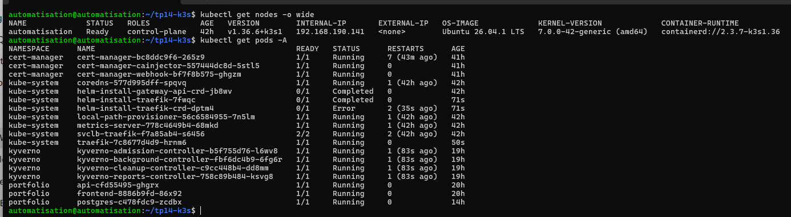
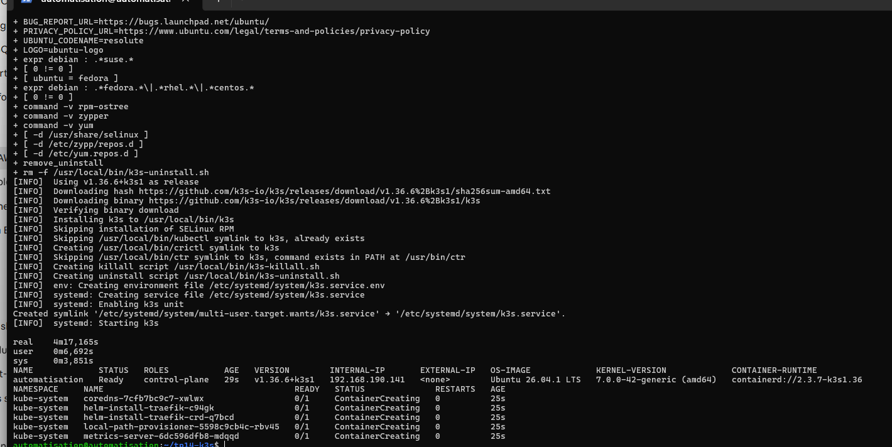
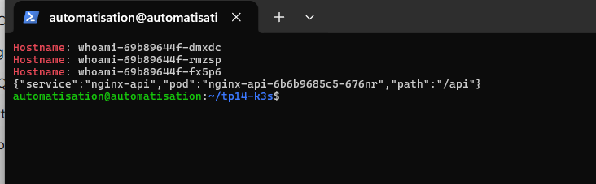
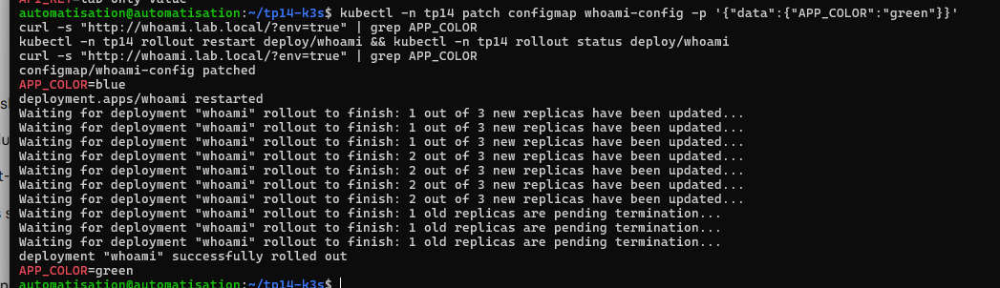
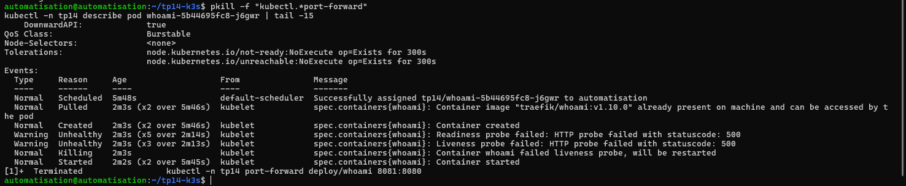
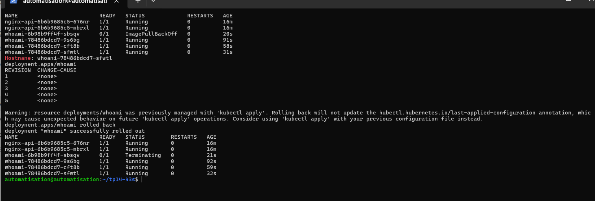
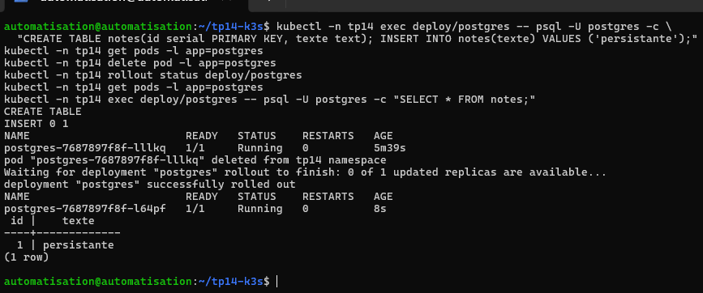
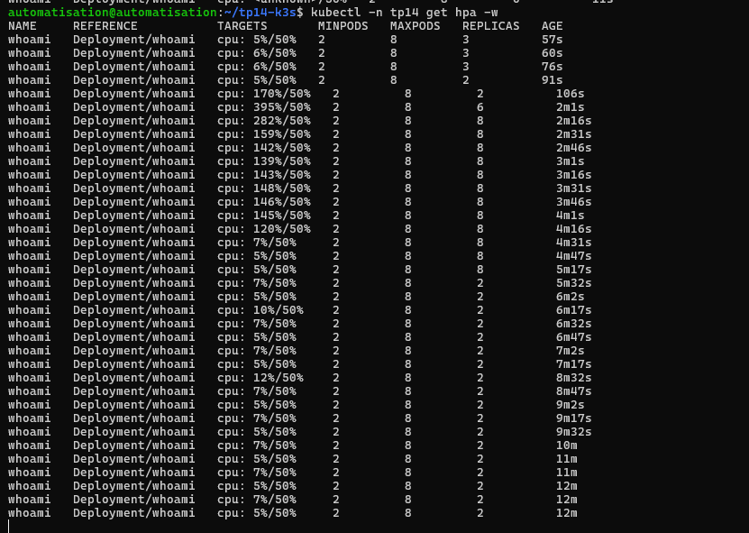

# TP14 : Kubernetes avec K3s

Cluster K3s à deux nœuds monté avec Vagrant + Ansible, puis découverte des objets Kubernetes (Namespace, Deployment, Service, Ingress, ConfigMap, Secret, PVC, HPA) sur l'application `traefik/whoami`.
Les réponses aux questions sont dans [REPONSES.md](REPONSES.md).

```
.
├── captures/                    ← 7 captures .png
├── k3s-lab/
│   ├── Vagrantfile              ← tableau NODES (1 server + 1 agent)
│   ├── ansible.cfg
│   ├── playbook.yml             ← appelle le rôle k3s
│   ├── roles/k3s/
│   │   ├── defaults/main.yml    ← version K3s épinglée (INSTALL_K3S_VERSION)
│   │   └── tasks/{main,server,agent}.yml
│   └── etapes/playbook-sans-role.yml   ← TODO complétés avant passage en rôle
└── k8s-starter/
    ├── 01-namespace.yaml  02-config.yaml  03-deployment.yaml
    ├── 04-service.yaml    05-ingress.yaml 05b-nginx-api.yaml
    ├── 06-postgres.yaml   07-hpa.yaml
    └── defi/08-pdb.yaml
```

Les Secrets (`whoami-secret`, `postgres-secret`) et le kubeconfig `k3s.yaml` ne sont **jamais** dans Git : ils sont créés en ligne de commande et listés dans `.gitignore`.

---

## 0. Vérifier la VM de lab

```bash
nproc                                  # >= 4
free -g                                # >= 8 Go
egrep -c '(vmx|svm)' /proc/cpuinfo     # > 0 : virtualisation imbriquée active
vagrant --version && VBoxManage --version && ansible --version | head -1
```

Si `egrep` renvoie 0 ou s'il manque de la RAM, passer au **Plan B** (section 0.b) : un seul nœud K3s sur la VM de lab. Les parties 2 à 7 sont identiques.

Installer kubectl :

```bash
curl -LO "https://dl.k8s.io/release/$(curl -Ls https://dl.k8s.io/release/stable.txt)/bin/linux/amd64/kubectl"
sudo install -m 0755 kubectl /usr/local/bin/kubectl && rm kubectl && kubectl version --client
```

### 0.b Plan B : K3s sur la VM de lab (un seul nœud)

```bash
sudo ss -ltnp | grep -E ':(80|443) '     # Traefik a besoin des ports 80/443 : arrêter ce qui les occupe
curl -sfL https://get.k3s.io | INSTALL_K3S_VERSION="v1.36.6+k3s1" sh -s - --write-kubeconfig-mode 644
mkdir -p ~/.kube && cp /etc/rancher/k3s/k3s.yaml ~/.kube/config && chmod 600 ~/.kube/config
echo "127.0.0.1 whoami.lab.local" | sudo tee -a /etc/hosts
kubectl get nodes -o wide
```

En Plan B, la reconstruction du cluster (`rebuild.png`) se fait avec :
`time (/usr/local/bin/k3s-uninstall.sh && curl -sfL https://get.k3s.io | INSTALL_K3S_VERSION="v1.36.6+k3s1" sh -s - --write-kubeconfig-mode 644)`.
Le préciser dans le rendu.

---

## 1. Partie 1 : cluster K3s avec Vagrant + Ansible

```bash
echo "192.168.56.10 whoami.lab.local" | sudo tee -a /etc/hosts
cd k3s-lab
vagrant up                     # 2 VM, puis Ansible une seule fois sur tout le cluster
mkdir -p ~/.kube && cp k3s.yaml ~/.kube/config && chmod 600 ~/.kube/config
kubectl get nodes -o wide      # 2 nœuds Ready
kubectl get pods -A            # coredns, traefik, local-path-provisioner, metrics-server
```

**Capture `cluster-nodes.png`** : `get nodes -o wide` (2 nœuds Ready) + `get pods -A`.

Le playbook livré utilise déjà le rôle `k3s`. La version « TODO complétés » avant transformation en rôle est dans `etapes/playbook-sans-role.yml`.

Reconstruction complète, chronométrée :

```bash
time (vagrant destroy -f && vagrant up)
cp k3s.yaml ~/.kube/config && kubectl get nodes
```

**Capture `rebuild.png`** : fin du `vagrant up`, ligne `real …` de `time` et `kubectl get nodes`.

---

## 2. Partie 2 : Pods et Deployments

```bash
cd ..                                        # racine du projet
kubectl run test --image=traefik/whoami:v1.10.0
kubectl get pods -o wide && kubectl delete pod test
kubectl get pods                             # le Pod n'est PAS recréé

kubectl apply -f k8s-starter/01-namespace.yaml -f k8s-starter/03-deployment.yaml
kubectl -n tp14 get deploy,rs,pods -o wide

kubectl -n tp14 get pods -w                  # terminal 2
kubectl -n tp14 delete pod <un-pod-whoami>   # terminal 1 : un nouveau Pod apparaît

POD=$(kubectl -n tp14 get pod -l app=whoami -o name | head -1)
kubectl -n tp14 describe $POD
kubectl -n tp14 logs $POD
kubectl -n tp14 exec -it $POD -- sh          # échoue : pas de shell dans l'image
kubectl -n tp14 debug -it $POD --image=busybox:1.37 --target=whoami -- sh   # alternative
kubectl explain deployment.spec.strategy
```

---

## 3. Partie 3 : Services et Ingress

```bash
kubectl apply -f k8s-starter/04-service.yaml
kubectl -n tp14 get svc,endpointslices
kubectl -n tp14 port-forward svc/whoami 8080:80 &
curl -s localhost:8080 | grep Hostname
kill %1                                      # relancer le port-forward : le Pod peut changer

kubectl -n tp14 run tmp --rm -it --image=busybox:1.37 --restart=Never -- \
  wget -qO- http://whoami.tp14.svc.cluster.local

kubectl apply -f k8s-starter/05b-nginx-api.yaml -f k8s-starter/05-ingress.yaml
kubectl -n tp14 get ingress
for i in 1 2 3; do curl -s http://whoami.lab.local | grep Hostname; done
curl -s http://whoami.lab.local/api
```

**Capture `ingress.png`** : `curl http://whoami.lab.local` (Hostname qui change) + `curl …/api` (JSON nginx).

---

## 4. Partie 4 : ConfigMap et Secret

```bash
kubectl apply -f k8s-starter/02-config.yaml
kubectl -n tp14 create secret generic whoami-secret --from-literal=api-key='lab-only-value'
kubectl -n tp14 get secret whoami-secret -o yaml
kubectl -n tp14 get secret whoami-secret -o jsonpath='{.data.api-key}' | base64 -d; echo

kubectl -n tp14 rollout restart deploy/whoami      # le Deployment référence déjà ConfigMap + Secret
kubectl -n tp14 rollout status deploy/whoami
curl -s "http://whoami.lab.local/?env=true" | grep -E 'APP_|API_KEY'

kubectl -n tp14 patch configmap whoami-config -p '{"data":{"APP_COLOR":"green"}}'
curl -s "http://whoami.lab.local/?env=true" | grep APP_COLOR    # toujours blue
kubectl -n tp14 rollout restart deploy/whoami && kubectl -n tp14 rollout status deploy/whoami
curl -s "http://whoami.lab.local/?env=true" | grep APP_COLOR    # green
```

---

## 5. Partie 5 : santé, ressources, déploiements progressifs

Probes (`/health`) et requests/limits sont déjà dans `03-deployment.yaml`.

```bash
kubectl -n tp14 port-forward deploy/whoami 8081:8080 &
curl -X POST -d '500' localhost:8081/health
kubectl -n tp14 get pods -w        # READY 0/1, puis RESTARTS 1 -> Ctrl+C
kill %1
```

**Capture `probes-restart.png`** : le Pod passe à `0/1` puis `RESTARTS 1`, et `kubectl -n tp14 describe pod <pod>` (événements `Liveness probe failed` et `Killing`).

Rolling update puis rollback :

```bash
kubectl -n tp14 set image deploy/whoami whoami=traefik/whoami:v1.10.1
kubectl -n tp14 rollout status deploy/whoami
kubectl -n tp14 set image deploy/whoami whoami=traefik/whoami:v9.9.9
kubectl -n tp14 get pods                       # ErrImagePull / ImagePullBackOff, les 3 anciens restent Running
curl -s http://whoami.lab.local | grep Hostname   # le service répond toujours
kubectl -n tp14 rollout history deploy/whoami
kubectl -n tp14 rollout undo deploy/whoami
kubectl -n tp14 rollout status deploy/whoami && kubectl -n tp14 get pods
```

**Capture `rollout-undo.png`** : `get pods` avec `ImagePullBackOff`, `rollout history`, `rollout undo` et les Pods revenus à l'état `Running`.

OOMKilled :

```bash
kubectl -n tp14 set resources deploy/whoami --limits=memory=4Mi
kubectl -n tp14 get pods
kubectl -n tp14 describe pod <nouveau-pod> | grep -iE -A3 'state|reason|oom'
kubectl -n tp14 rollout undo deploy/whoami     # retour aux 64Mi
```

---

## 6. Partie 6 : stockage persistant

```bash
kubectl -n tp14 create secret generic postgres-secret --from-literal=password='lab-only-pg'
kubectl apply -f k8s-starter/06-postgres.yaml
kubectl -n tp14 rollout status deploy/postgres

kubectl -n tp14 exec -it deploy/postgres -- psql -U postgres -c \
  "CREATE TABLE notes(id serial PRIMARY KEY, texte text); INSERT INTO notes(texte) VALUES ('persistante');"
kubectl -n tp14 delete pod -l app=postgres
kubectl -n tp14 rollout status deploy/postgres
kubectl -n tp14 get pods -l app=postgres       # nouveau nom de Pod
kubectl -n tp14 exec -it deploy/postgres -- psql -U postgres -c "SELECT * FROM notes;"
kubectl get pv,pvc -n tp14
```

**Capture `pvc-persistence.png`** : suppression du Pod, nouveau Pod, `SELECT` qui renvoie toujours `persistante`.

Emplacement physique des données :

```bash
kubectl get pv -o jsonpath='{.items[0].spec.local.path}{"\n"}{.items[0].spec.nodeAffinity}{"\n"}'
```

---

## 7. Partie 7 : HorizontalPodAutoscaler

```bash
kubectl top nodes && kubectl top pods -n tp14
kubectl apply -f k8s-starter/07-hpa.yaml

# Terminal 1
kubectl -n tp14 get hpa -w
# Terminal 2 : charge (Ctrl+C pour arrêter, puis observer la descente au bout d'environ 1 minute)
kubectl -n tp14 run load --rm -it --image=busybox:1.37 --restart=Never -- \
  sh -c 'while true; do wget -qO- http://whoami >/dev/null; done'
```

**Capture `hpa.png`** : `get hpa -w` avec `TARGETS` qui monte au-dessus de 50 %, `REPLICAS` 2 → 4+, puis qui redescend.

---

## 8. Défis

Troisième nœud : décommenter la ligne `k3s-agent2` dans `NODES`, puis :

```bash
cd k3s-lab && vagrant up k3s-agent2 && vagrant provision k3s-agent2 && cd ..
kubectl get nodes
kubectl drain k3s-agent1 --ignore-daemonsets --delete-emptydir-data
kubectl -n tp14 get pods -o wide              # les Pods sont partis sur les autres nœuds
kubectl uncordon k3s-agent1
```

PodDisruptionBudget :

```bash
kubectl apply -f k8s-starter/defi/08-pdb.yaml
kubectl delete hpa whoami -n tp14 && kubectl -n tp14 scale deploy/whoami --replicas=1
kubectl drain <nœud-du-pod-whoami> --ignore-daemonsets --delete-emptydir-data --timeout=30s
# -> "Cannot evict pod as it would violate the pod's disruption budget"
kubectl uncordon <nœud>
```

## 9. Nettoyage

```bash
kubectl delete namespace tp14
cd k3s-lab && vagrant destroy -f            # Plan B : /usr/local/bin/k3s-uninstall.sh
```

## Rendu

* `captures/` : `cluster-nodes.png`, `rebuild.png`, `ingress.png`, `probes-restart.png`, `rollout-undo.png`, `pvc-persistence.png`, `hpa.png`
* `k3s-lab/` : `Vagrantfile`, `playbook.yml`, `roles/k3s/`
* `k8s-starter/` : manifests complétés
* Jamais `k3s.yaml`, `.vagrant/` ni de Secret (voir `.gitignore`)

## Captures

**cluster-nodes**



**rebuild**



**ingress**



**probes-restart**



**probes-restartt**



**rollout-undo**



**pvc-persistence**



**hpa**


